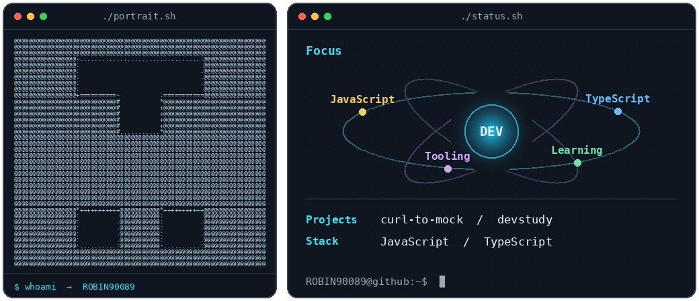

### `ROBIN90089@github ~ $ ./contributions.sh`

  

### `ROBIN90089@github ~ $ whoami`

  

### `ROBIN90089@github ~ $ ./links.sh`

[`GitHub`](https://github.com/ROBIN90089) &nbsp;·&nbsp;
[`curl-to-mock`](https://github.com/ROBIN90089/curl-to-mock) &nbsp;·&nbsp;
[`devstudy`](https://github.com/ROBIN90089/devstudy)

